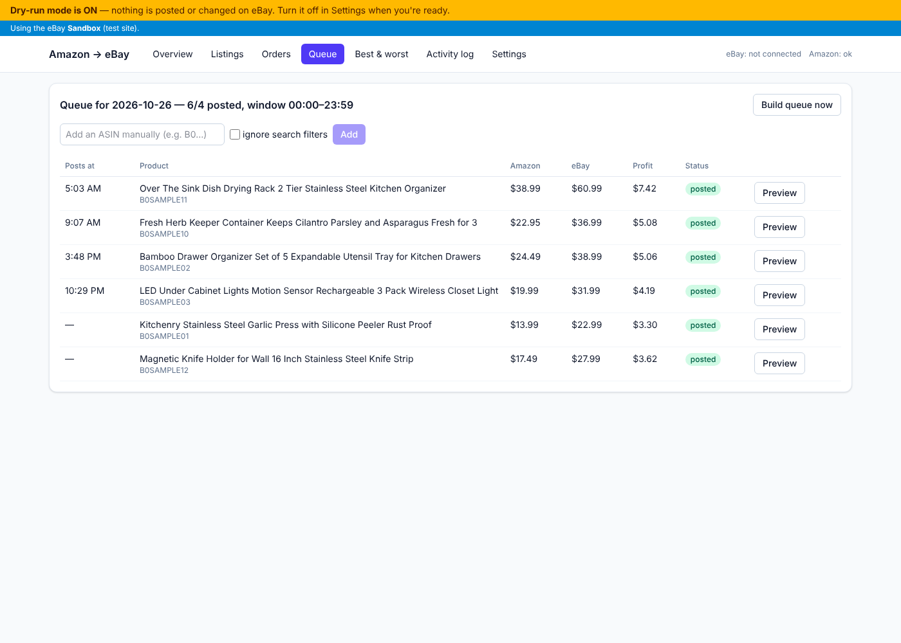

# Amazon → eBay Listing Automation

A local app that runs 24/7 on your PC. It finds products on Amazon, lists them on your eBay store with your markup, keeps prices and stock in sync, helps you fulfill orders, and shows everything on a dashboard at **http://localhost:8000**.

- **Dry-run mode is ON by default.** The app finds, prices and previews listings but never creates or changes anything on eBay until you turn dry-run off.
- **Sandbox first.** You can test against eBay's sandbox (test site), then switch to your real store with one setting.
- Every setting is on the **Settings** page. You never need to edit code.



---

## Before you start: read these risks

- **eBay's dropshipping policy.** eBay doesn't allow listing an item and then buying it from another retailer that ships straight to your buyer, as Amazon does. Accounts doing this can be limited or suspended. This app can't change that. You decide whether to accept that risk.
- **Amazon's terms.** Amazon's Conditions of Use prohibit automated data collection. The app paces requests like a person and never tries to get past a CAPTCHA (it pauses instead), but Amazon can still block your IP or account. Auto-buy places real orders with your saved card.
- **VeRO.** The starter brand blocklist is a starting point, not a complete list. Review it and add brands you've had trouble with.
- **Item location.** Some courses suggest listing with ZIP codes where the item isn't located. eBay requires an accurate item location, so this app uses the single ZIP you enter.

---

## What you need

- Your PC (Windows, Mac or Linux) with **Python 3.11+** ([python.org](https://www.python.org/downloads/); on Windows tick "Add python.exe to PATH") and **Node.js 20+** ([nodejs.org](https://nodejs.org)).
- An eBay seller account and a free **eBay developer account** ([developer.ebay.com](https://developer.ebay.com)).
- An Amazon account (for tracking and auto-buy).

---

## Step 1: Install

1. Download this project (on GitHub: **Code → Download ZIP**, then unzip), or `git clone` it.
2. Open a terminal in the project folder and run the setup script:
   - **Windows (PowerShell):** `powershell -ExecutionPolicy Bypass -File scripts\setup.ps1`
   - **Mac / Linux:** `bash scripts/setup.sh`

   This creates a Python environment, installs everything (including the Chromium browser Playwright uses), builds the dashboard, and creates your `.env` file from `.env.example`.

---

## Step 2: Get your eBay keys

1. Sign in at [developer.ebay.com](https://developer.ebay.com) → your name (top right) → **Application Keysets** (sometimes shown as **Application Keys**).
2. Create a keyset if you don't have one. You get **two**: **Sandbox** and **Production**. Production may need you to finish the account-deletion step (Step 4) before eBay enables it.
3. Each keyset shows three values. Copy them into `.env`:

| eBay calls it | Also shown as | Goes in `.env` as |
|---|---|---|
| App ID | Client ID | `EBAY_SANDBOX_APP_ID` / `EBAY_PROD_APP_ID` |
| Dev ID | | `EBAY_SANDBOX_DEV_ID` / `EBAY_PROD_DEV_ID` |
| Cert ID | Client Secret | `EBAY_SANDBOX_CERT_ID` / `EBAY_PROD_CERT_ID` |

Keep the quotes, e.g. `EBAY_SANDBOX_APP_ID="YourName-MyApp-SBX-1234abcd-5678efgh"`. **Never share `.env`.** It's already excluded from git.

---

## Step 3: Set up the redirect URL (RuName)

The RuName is the name eBay gives your sign-in redirect. Do this **once for Sandbox and once for Production**:

1. On the Application Keysets page, next to the keyset, click **User Tokens**.
2. Choose **Get a Token from eBay via Your Application**, then **Add eBay Redirect URL**.
3. Fill in:
   - **Display title:** your store name (buyers never see this; you see it on the eBay consent page).
   - **Your privacy policy URL:** required. Any public page you control works, e.g. a short privacy note published as a Google Doc ("File → Share → Publish to web") or a page on your store.
   - **Your auth accepted URL:** **keep eBay's default** (eBay's own "Thank you / authorization successful" page on `signin.ebay.com`, or `signin.sandbox.ebay.com` for sandbox). The app reads the code from that page's address, so no public website is needed.
   - **Your auth declined URL:** keep eBay's default.
   - Make sure **OAuth** is selected (not "Auth'n'Auth").
4. Save. Copy the **RuName (eBay Redirect URL name)**, which looks like `Your_Name-YourName-MyApp-SBX-abcdefgh`, into `.env` as `EBAY_SANDBOX_RUNAME` or `EBAY_PROD_RUNAME`.

---

## Step 4: Marketplace Account Deletion (needed for production keys)

eBay requires production apps to either receive "a user deleted their eBay account" notices, or claim an exemption. The exemption is only for apps that **don't store eBay user data**. This app stores buyer names and addresses for fulfillment, so it **implements the endpoint** instead:

- The endpoint runs on a **separate port (8001)** that only handles these notices, so making it public never exposes your dashboard.
- When a notice arrives, the app verifies eBay's signature and erases that buyer's name and address from your orders.

What you do:

1. **Make port 8001 reachable over HTTPS with a URL that doesn't change.** The simplest free option is an **ngrok static domain**:
   - Sign up at [ngrok.com](https://ngrok.com), install ngrok, and claim your free static domain in the ngrok dashboard (e.g. `your-name.ngrok-free.app`).
   - Run `ngrok http --url=your-name.ngrok-free.app 8001`, and add it to your PC's startup (e.g. in the same Task Scheduler as Step 8) so it's always on.
   - Alternative: Cloudflare Tunnel with your own domain.
2. Pick a verification token: any **32–80 characters** of letters, numbers, `_` or `-`. A password generator works.
3. In `.env` set:
   ```
   EBAY_VERIFICATION_TOKEN="your-32-to-80-character-token"
   EBAY_DELETION_ENDPOINT_URL="https://your-name.ngrok-free.app/ebay/account-deletion"
   ```
   Restart the app.
4. On developer.ebay.com → **Alerts & Notifications** (Application Keysets page, for the **production** keyset) → **Marketplace Account Deletion**: enter your email, the **same endpoint URL**, and the **same verification token**, then **Save**. eBay immediately sends a test challenge; the app answers it automatically. Click **Send Test Notification** to confirm.

---

## Step 5: Finish `.env`

Open `.env` in Notepad (or any text editor). After Steps 2–4 it should have your App ID, Dev ID, Cert ID and RuName for sandbox (and production when ready), plus the two account-deletion values. Leave the `*_REFRESH_TOKEN` lines **blank**; the app fills them in when you connect. `ANTHROPIC_API_KEY` is optional (see "Listing content" below).

---

## Step 6: Start the app and connect eBay

1. Start it:
   - **Windows:** `backend\.venv\Scripts\python.exe backend\run.py`
   - **Mac / Linux:** `backend/.venv/bin/python backend/run.py`
2. Open **http://localhost:8000** → **Settings**.
3. Under **eBay connection**, click **Connect eBay**. A new tab opens on eBay. Sign in (for sandbox, use a **sandbox test user**, created on developer.ebay.com → **Sandbox → User accounts**) and click **Agree**.
4. eBay shows a "you can close this window" page. **Copy the whole address bar** of that page, paste it into **"Finish connecting"**, and click it. The status turns **Connected**. The refresh token is saved to `.env` and renewed automatically (it lasts about 18 months; reconnect if the dashboard says it's expiring).
5. Under **Listing defaults**, click **Load my eBay business policies** and choose your shipping, return and payment policies. If eBay says you're not opted in to business policies, click **Opt in** and create policies in Seller Hub (`sandbox.ebay.com` for sandbox). Enter your **item location ZIP**.
   - The pricing formula assumes **free shipping**, so pick a free-shipping policy. The app warns you if you don't.
   - Handling time comes from the shipping policy. The app warns if it doesn't match your setting.

### Log in to Amazon once (for tracking and auto-buy)

Settings → **Amazon scraper** → **Open Amazon browser (log in once)**. A browser window opens on your PC. Log in to Amazon (tick "Keep me signed in"), then close the window. The login is kept in `data/amazon_profile`. The app never sees or stores your password or card.

---

## Step 7: Tour of the settings

| Section | What you control |
|---|---|
| **Mode** | Dry-run on/off, sandbox ↔ production, product data source (Amazon, or offline sample data for testing) |
| **Pricing engine** | Margin multiplier, eBay fee %, fixed fee per order, promo ad rate %, the sales tax Amazon charges you (6.0% default), buyer-tax estimate (6%), minimum profit $ and/or % of Amazon cost, rounding (.99 style). The **price calculator** shows the full breakdown for any Amazon price. |
| **Product finder** | Listings per day, posting window (default 8 AM–10 PM, randomized), daily queue-build time, keywords, Amazon categories, pages per search, queue backup size |
| **Filters** | Min/max Amazon price, min rating, min reviews, Prime only, in stock only, max shipping days |
| **Listing defaults** | Quantity, handling time, business policies, item location, Promoted Listings campaign, optional **description template**, optional Claude writer |
| **Price & stock refresh** | **Auto refresh on/off**; **every day at a set time** (default 3:00 AM), **once a week** on a set day/time, or **every N hours**; **apply changes to eBay automatically** (or just flag them for review); what to do when Amazon is out of stock (qty 0 / end) or profit falls below your floor (qty 0 / end / flag) |
| **Orders & checkout** | Assisted vs auto checkout, kill switch, max order $, max orders/day, max spend/day, hold if delivery isn't free, how often to sync orders and check tracking |
| **Amazon scraper** | Max pages per hour, random delay range, cache time, cooldown after a CAPTCHA, hidden vs visible browser |
| **Blocklist** | Add/remove/import CSV of brands and keywords; scan active listings and flag or end matches |

### How the nightly refresh works

At the time you set (or on your chosen interval), the app re-opens every active listing's Amazon page (reusing data fetched within the cache window):

- **Price changed:** it recalculates with your pricing formula. If the rounded eBay price is different, it updates eBay.
- **Out of stock:** sets quantity to 0 (or ends the listing, your choice). When stock returns, it restores quantity and reprices.
- **Profit below your floor:** applies your chosen action.
- Every check is saved to the listing's **price history chart**, and every change goes in the activity log. **Refresh now** buttons are on the Listings page and on each listing.

### How money is calculated

Pricing (exactly as specified):
```
amazon_cost = amazon_price × (1 + sales_tax%)
raw_price   = amazon_cost × margin × (1 + ebay_fee%) × (1 + promo%) + fixed_fee
ebay_price  = .99 rounding of raw_price
profit      = ebay_price − amazon_cost − (ebay_price × (1 + buyer_tax%) × ebay_fee% + fixed_fee) − ebay_price × promo%
```
- **Minimum profit %** is measured against Amazon cost incl. tax (ROI).
- **Dashboard net profit** = revenue (incl. buyer tax) − buyer tax (eBay pays it to the state) − Amazon spend (minus Amazon refunds you enter) − eBay fees − promo fees − refunds to buyers.
- eBay fees come from eBay's **Finances API** once eBay reports them. Until then, the formula's estimate is used and marked **est.** The same goes for Amazon cost before you enter what you paid.

### Orders

- **Assisted (default):** a new order shows as **Needs purchase**. Click **Buy / details** → **Open Amazon product page** and use the copy buttons for the buyer's name and address. Enter your Amazon order # and total paid.
- **Auto:** the app buys on Amazon using your logged-in browser and saved default card. Before ordering it re-checks the live Amazon price and reads the real checkout total. It **won't buy** if:
  - the order would be unprofitable,
  - it's over your $ cap, daily count or daily spend,
  - delivery isn't free (if you chose that),
  - the checkout page doesn't show the buyer's address, or
  - the kill switch is on.

  An order is never auto-bought twice. Anything unusual is flagged for you, with a screenshot.
- **Tracking:** the app reads tracking from your Amazon order page.
  - UPS, USPS and FedEx numbers are uploaded to eBay automatically.
  - **Amazon Logistics (TBA…) numbers are never uploaded.** The order is flagged **TBA – manual action** for you to decide.
  - No tracking-conversion services are used.
- **Refunds, returns, cancellations** sync from eBay. Enter Amazon refunds you receive on the order so profit stays accurate.

### Listing content

- Titles are cleaned to at most 80 characters, with no "Amazon's Choice", emoji, repeated keywords or dangling words.
- Descriptions are rebuilt from the product's features (marketing and warranty lines removed) plus a spec table, using your own template if you set one.
- Item specifics come from Amazon's details, matched to what the eBay category asks for.
- The category comes from eBay's Taxonomy API suggestions.
- **Optional:** put an `ANTHROPIC_API_KEY` in `.env` and turn on "Write titles/descriptions with Claude" for fully original wording. It falls back to the built-in writer on any problem.

---

## Step 8: Make it start automatically

Run once, after setup:

- **Windows:** `powershell -ExecutionPolicy Bypass -File service\windows\install-autostart.ps1`
  - Creates a Task Scheduler task that starts the app when you log in and restarts it if it stops.
  - Since your PC never turns off, also turn on automatic sign-in so it comes back after Windows updates. Search "netplwiz", or use Settings → Accounts → Sign-in options.
- **Mac:** `bash service/macos/install-autostart.sh` (a launchd agent that starts at login and stays running)
- **Linux:** `bash service/linux/install-autostart.sh` (a systemd user service that starts at boot)

---

## Step 9: Recommended first run

1. **Sandbox + dry-run.**
   - Connect eBay in sandbox, load policies, set keywords and filters.
   - Click **Queue → Build queue now**. Open **Preview** on a few items and check the title, description, specifics, category and price breakdown.
2. **Sandbox live.** Turn dry-run off (still sandbox). Let it post a few listings, then check them on sandbox.ebay.com and in **Listings**.
3. **Production + dry-run.**
   - Switch to production. Turn dry-run **back on**, connect eBay (production), load your real policies.
   - Let it build a queue and run a refresh for a day or two. Watch the **Activity log** for skipped products and their reasons.
4. **Go live slowly.** Set **Listings per day** to 2–3, turn dry-run off, and watch the first orders closely before raising the number.

**Testing without Amazon:** set *Product data source* to "Offline sample data". The whole pipeline then runs on 12 built-in fake products, including ones that get skipped by each filter, the blocklist and the profit floor.

---

## Everyday use

- **Overview:** KPIs (with date range), revenue/profit, orders and listings charts
- **Listings:** sortable table; click a row for the breakdown, price history and orders
- **Orders:** buyer details with copy buttons, purchase, tracking, refunds, status
- **Queue:** today's products and posting times; remove, add an ASIN, post now, preview
- **Best & worst:** top earners, money-losers, listings with views but no sales
- **Activity log:** everything the app did, filterable
- **Banners** at the top warn when dry-run is on, you're in sandbox, or Amazon jobs are paused after a CAPTCHA (they resume by themselves after the cooldown).

## Where things are stored

- `.env`: your keys and tokens
- `data/app.db`: database (settings, listings, orders, logs). Back up this file.
- `data/amazon_profile`: the Amazon browser profile
- `data/screenshots`: auto-buy screenshots

## For developers

- Backend: FastAPI + SQLAlchemy (SQLite) + APScheduler, in `backend/app`. Frontend: React + Vite + Tailwind, in `frontend/`.
- Product sources implement `backend/app/providers/base.py::ProductProvider`.
- Run tests: `cd backend && .venv/bin/python -m pytest` (Windows: `.venv\Scripts\python -m pytest`). They cover the pricing engine (including the rounding examples), the profit floor, the blocklist, parsing, the dry-run pipeline, and live flows against a mocked eBay API.
- Dashboard dev server: `cd frontend && npm run dev` (proxies the API to :8000).
